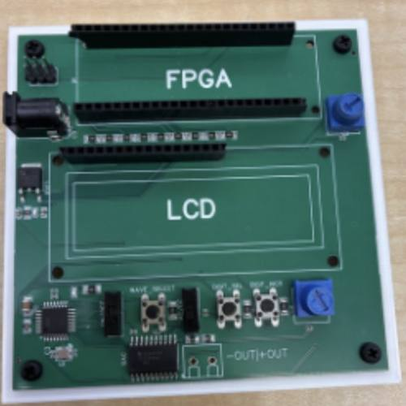
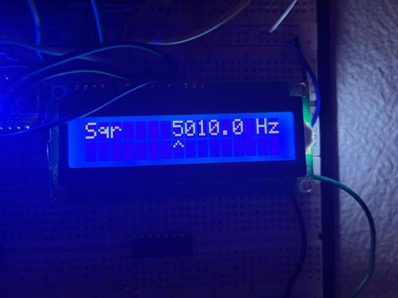
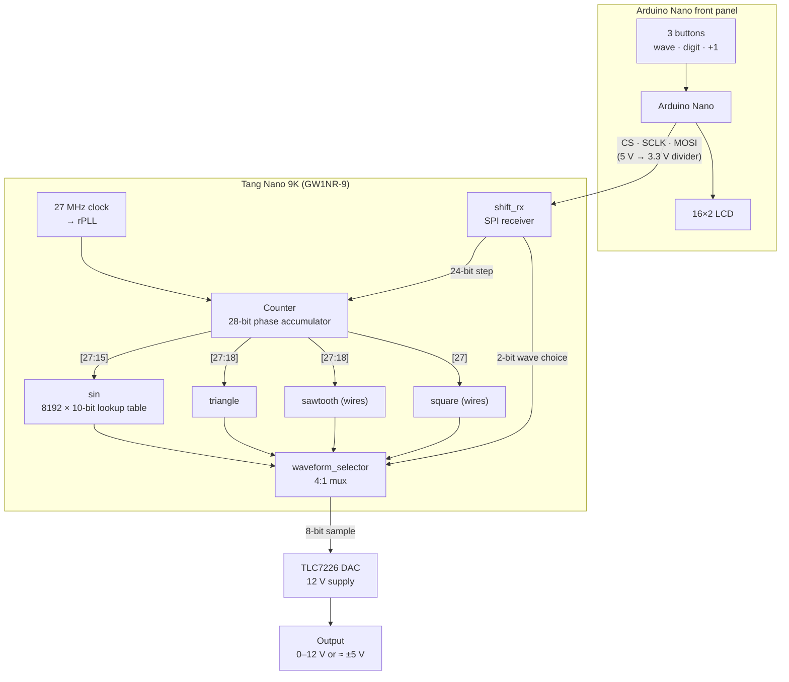

# FPGA DDS Waveform Generator

A bench-style function generator built on a **Gowin GW1NR-9 FPGA (Tang Nano 9K)**. It makes **sine, square, triangle and sawtooth** waves from **0.1 Hz to 50 kHz** using Direct Digital Synthesis (DDS). An **Arduino Nano** runs the front panel: three buttons and a 16×2 LCD. It sends each new setting to the FPGA over a bit-banged SPI link, and an **8-bit DAC** turns the samples into a real analog signal of about ±5 V.

▶️ **[Demo video](https://youtu.be/BfvZAybBdLo)**

| Custom PCB | Front-panel LCD |
|---|---|
|  |  |

Built as my Independent Study Project for the Advanced Computer Engineering program at Royal St. George's College (2026).

---

## Highlights

- **DDS core in Verilog:** a 28-bit phase accumulator, with all four waveforms made from the same phase value.
- **Sawtooth and square need almost no logic:** the sawtooth is the top 10 bits of the accumulator, and the square is its top bit.
- **Triangle without a lookup table:** the top bit says whether the wave is rising or falling, and the lower bits are inverted on the way down.
- **8192-entry sine lookup table**, generated by a Python script ([`tools/gen_sine_rom.py`](tools/gen_sine_rom.py)) instead of typed by hand.
- **Neat tuning word:** the 27 MHz clock divided by 2²⁸ is about 0.1 Hz, so the Arduino sends the frequency in tenths of a hertz and the FPGA uses it directly as the phase step. No multiply or divide is needed on either side (details [below](#frequency-math)).
- **Custom PCB** with the FPGA, LCD, buttons, DAC, power and a selectable AC/DC output reference.

---

## How it works



### Phase accumulator

On every clock cycle, the `Counter` module adds the 24-bit **step** to a 28-bit register. The register wraps around at 2²⁸, so its value climbs steadily from 0 to the maximum and then starts over. One trip around is one period of the output wave. A bigger step means the register wraps sooner, so the output frequency is higher.

### Frequency math

```
f_out = STEP × f_clk / 2^28

f_clk = 27 MHz  →  resolution = 27,000,000 / 268,435,456 ≈ 0.1006 Hz per step
```

Because one step is almost exactly 0.1 Hz, the Arduino just sends `frequency × 10` as the step: for example, `5000.0 Hz → STEP = 50000`. The output ends up about 0.6 % higher than the number on the screen, and no maths is needed on either chip.

| Setting | STEP sent | Actual output |
|---|---|---|
| 0.1 Hz | 1 | 0.1006 Hz |
| 1 kHz | 10,000 | 1.006 kHz |
| 50 kHz (max) | 500,000 | 50.29 kHz |

### Waveforms

| `wave_choice` | Wave | How it's made |
|:---:|---|---|
| `00` | Square | `counter_out[27] ? 10'h3FF : 10'h000`: high for the first half of the cycle, low for the second |
| `01` | Triangle | Rises on the first half of the cycle, then inverts the lower 9 bits to fall on the second half (see [`triangle.v`](src/triangle.v)) |
| `10` | Sawtooth | `counter_out[27:18]`: the top 10 bits of the accumulator |
| `11` | Sine | `counter_out[27:15]` is the address into an 8192-entry table holding one full sine period |

Each wave is 10 bits wide. The sine table is centred at `0x200` (512): it peaks at `0x3FF` (1023) and bottoms out at `0x000` (0). Each entry is `min(1023, round(512 + 512·sin(2πi/8192)))`.

### Arduino → FPGA link

The Arduino sends a 32-bit frame **MSB first** on three pins, using SPI Mode 0:

```
 bit 31        26 25                        2  1    0
┌──────────────┬────────────────────────────┬────────┐
│  6 unused    │  24-bit step (freq × 10)   │  wave  │
└──────────────┴────────────────────────────┴────────┘
   sent first                                sent last
```

1. CS (`start_pin`) goes low.
2. The Arduino sends 32 bits. The FPGA shifts one bit into a 26-bit register on every rising edge of SCLK, and the 6 unused top bits fall off the end.
3. CS goes high, and the FPGA copies the register into `freq_data` and `wave_choice`.

The receiver is only a few lines long: see [`shift_rx.v`](src/shift_rx.v).

The Arduino runs at 5 V and the FPGA pins at 3.3 V, so a **resistor voltage divider** on each line brings the signal down to a safe level.

### Analog output

The mux output feeds one channel of a **TLC7226** quad 8-bit DAC. The DAC is powered from 12 V, so a full-scale code gives close to 12 V out. A two-position switch picks the output reference:

- **DC:** referenced to real ground, so the output swings from 0 to about 12 V.
- **AC:** referenced to a mid-rail point made with a resistor divider, so the output swings about ±5 V around 0 V, like a bipolar bench generator.

---

## Hardware

| Part | Role |
|---|---|
| Sipeed Tang Nano 9K (Gowin GW1NR-LV9QN88PC6/I5) | DDS core |
| Arduino Nano (ATmega328P) | Buttons, LCD, sends settings to the FPGA |
| 16×2 character LCD (HD44780) | Shows the wave type and frequency |
| TLC7226 quad 8-bit DAC | Turns samples into a voltage |
| Custom PCB, 12 V barrel jack | Holds and powers everything |

### FPGA pins ([`wave_generator.cst`](src/wave_generator.cst))

| Signal | Pin(s) | Notes |
|---|---|---|
| `clkin` | 52 | 27 MHz on-board crystal |
| `start_pin` (CS) | 36 | From Arduino D4 |
| `data_pin` (MOSI) | 37 | From Arduino D6 |
| `clk_pin` (SCLK) | 38 | From Arduino D7 |
| `pwm_out[9:2]` | 70–77 | 8-bit sample to the DAC |
| `pwm_out[1:0]` | 49, 48 | Low 2 bits |

The port is named `pwm_out` for historical reasons. It's a parallel 10-bit bus, not PWM.

---

## Repository layout

```
├── src/
│   ├── top.v                 # top level: wires every module together
│   ├── Gowin_rPLL.v          # Gowin rPLL IP wrapper (27 MHz in)
│   ├── shift_rx.v            # SPI receiver for the Arduino link
│   ├── Counter.v             # 28-bit phase accumulator
│   ├── sin.v                 # 8192 × 10-bit sine lookup table (generated)
│   ├── triangle.v            # triangle wave from the phase value
│   ├── waveform_selector.v   # 4:1 output mux
│   └── wave_generator.cst    # pin constraints
├── arduino/
│   └── wave_generator_ui/
│       └── wave_generator_ui.ino   # buttons, LCD, sends the 32-bit frame
├── tools/
│   └── gen_sine_rom.py       # generates the sine table values
└── docs/images/
```

---

## Build and run

**FPGA (Gowin IDE, Education edition)**
1. Create a new project for device **GW1NR-LV9QN88PC6/I5** (Tang Nano 9K).
2. Add every file in `src/`, and set `top` as the top module.
3. Run **Synthesize → Place & Route**, then program the board with the Gowin Programmer.

**Arduino**
1. Open `arduino/wave_generator_ui/wave_generator_ui.ino` in the Arduino IDE. It needs the built-in `LiquidCrystal` library.
2. Select **Arduino Nano** and upload.

**Using it**
- **Wave** button (A0): cycles Square → Triangle → Sawtooth → Sine.
- **Digit** button (A1): moves the `^` cursor to the next digit.
- **+1** button (A2): increases the selected digit by one, from 0.1 Hz up to the 10 kHz place, with a 50 kHz maximum.

**Regenerating the sine table**
```bash
python tools/gen_sine_rom.py
```
This writes `sine_init.txt`, one `memory[i] = 10'h...;` line per entry. Paste those lines into the `initial begin` block of `src/sin.v`. Change `num_samples` to change the table size.

---

## What I learned

- **Thinking in hardware, not software.** An FPGA isn't a microcontroller running steps in order. It's a chip you rewire into exactly the circuit you need, with every module running at the same time.
- **Modular design.** Each block has clear inputs and outputs and is wired up in `top.v`, the same way you'd chain chips on a breadboard, except each chip can be rewritten in seconds.
- **DDS and fixed-point maths.** Picking the accumulator width and step format so that one step works out to about 0.1 Hz meant neither the Arduino nor the FPGA needed any arithmetic.
- **Generating code with scripts.** Writing a 200 KB lookup table by hand is impossible, but a short Python script makes it in under a second.
- **Mixed-voltage design:** bringing 5 V logic down to 3.3 V inputs, and building a mid-rail reference to get a bipolar output from a single 12 V supply.
- **PCB bring-up.** On the first board, I put an ATmega328P directly on the PCB to program over ISP, but I could never upload code to it reliably. Most likely the ISP, reset or power wiring was wrong, so that board revision had to be redone.

## Possible improvements

- Send the DAC all 10 bits, or use a 10-bit DAC, so the extra resolution isn't wasted.
- Add a check that rejects incomplete frames, and pass the new step safely between the two clock domains.
- Store only a quarter of the sine wave and mirror it, which cuts the table to a quarter of its size.
- Add amplitude and DC-offset control.
